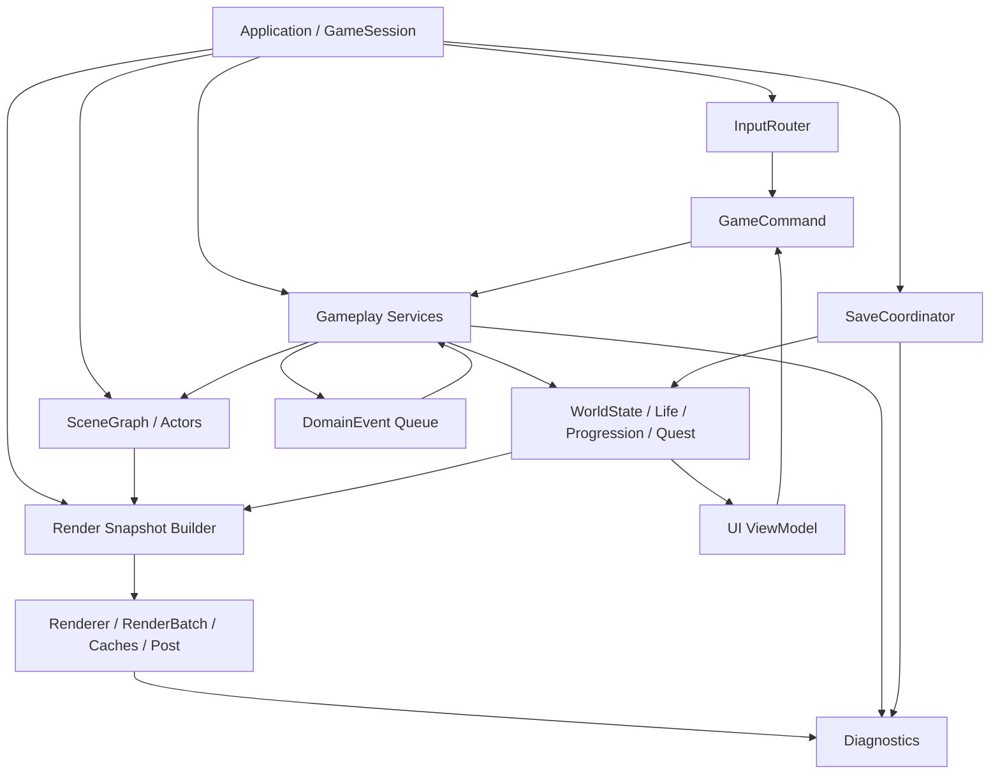

> 2026-10-27 최신 구현: [월드·자산 연동 보완 기록](WORLD_COMPLETION_KR.md)을 우선한다. 중심 간 5청크(약 20.21초), SQLite/V6 저장, 원거리 C++ 작업자, MD 계약 재적용, 별도 Blender 내보내기 및 J/C 애니메이션을 추가했다. 게임 빌드·실행 검수는 사용자가 진행한다.

> 2026-10-26 구현 확장: 마을·주민·이동·통신·주택의 현재 명세는 [일곱 마을 확장](SEVEN_TOWNS_KR.md)을 우선한다. 레벨 1 이후 진행은 [꺼진 종탑](LEVEL_TWO_KR.md), Blender 자산은 [제작 파이프라인](BLENDER_ASSET_PIPELINE_KR.md)을 참조한다. 이전의 세 소규모 거점/18명 설정은 7개 마을/기본 210명으로 대체되었다.

# 재의 계승 — 최종 시스템·코드 구조 설계

> **추가 변경 1.2:** [가중치 전이·리젠·즉시 부활](SOCIETY_TRANSITIONS_KR.md)을 우선 적용한다. 직업별 고정 분기 대신 다섯 행동 점수로 선택하며, 사냥터 4자리/2초 리젠·일반 몬스터 5초 리젠·NPC 동일 ID 즉시 부활/3초 보호를 적용했다. 저장은 월드 V4/사회 V2다. 빌드·실행 검수 전이다.


> **2026-10-06 추가 명세:** [생활하는 오픈월드 프로토타입](LIVING_WORLD_PROTOTYPE_KR.md)을 먼저 읽는다. 사용자 추가 조건에 따라 마을·직업·목표·거래·약탈·PK·실시간 주민 갱신을 우선 구현했다. 아래의 장기 이야기/구조 계획은 계속 유지하되, NPC 무적·영구 자원 소진·대화 중 정지·저장 버전 관련 충돌은 추가 명세를 따른다. 소스 구현과 실제 실행 검수 완료는 구분한다.


> 버전 1.0 · 2026-10-06 · [마스터 기획서](GAME_MASTER_PLAN_KR.md)와 함께 사용한다.  
> 현재 구조와 목표 구조를 구분한다. 아래의 새 서비스·폴더·데이터 형식은 구현 계획이며 이미 존재하는 파일이 아니다.

## 1. 설계 원칙

1. 기존 C++17/OpenGL 3.3 실행 기반을 유지하고 기능별로 이전한다.
2. 월드의 배치 대상은 Actor이며, 생성·계층·수명은 SceneGraph가 소유한다.
3. Actor는 자신의 행동을 수행하고, 영구 상태와 여러 Actor에 걸친 규칙은 서비스가 관리한다.
4. UI와 렌더러는 게임 규칙을 변경하지 않는다. 입력은 명령으로, 출력은 읽기 전용 상태로 전달한다.
5. 저장 데이터, 런타임 오브젝트, 파생 캐시를 구분한다.
6. 지역 언로드·캐시 퇴거·GPU 자원 해제는 게임 속 파괴/사망과 다르다.
7. 한 기능을 옮길 때 호출 경로와 검수 항목도 함께 옮긴다. 전체 교체 후 한꺼번에 확인하지 않는다.

## 2. 현재 실행 구조

```text
SimpleGame.cpp                 창 / OpenGL 초기화 / 콜백 / 프레임 경계
  └─ WorldScene.cpp            입력 / UI / Game와 렌더러 연결
      ├─ Ashen::Game           세션, 저장, 지역/관계/성장 상태, 공유 규칙
      │   └─ SceneGraph       unique_ptr<Actor> 소유 / 계층 / 갱신 / 지연 삭제
      │       ├─ PlayerActor
      │       ├─ 청크 루트 Actor
      │       │   ├─ WorldActor: 지형·건물·나무·잔해
      │       │   ├─ EnemyActor / HeirActor
      │       │   ├─ HerbActor / FireActor / SettlerActor / GraveActor
      │       │   └─ DropActor
      │       └─ ProjectileActor
      └─ AshenRenderer
          ├─ RenderBatch      순서 보존 인스턴싱 큐
          ├─ MeshCache        GPU 공유 아틀라스 / LRU
          ├─ DiskMeshCache    형상 파일 검증·저장·로딩
          ├─ ShaderProgram   외부 .vs/.fs 로딩
          ├─ PostProcessing  HDR / Bloom / 비넷 / 블러
          └─ RenderProfiler  프레임·배치·캐시 로그
```

현재 `Game`에는 전투/충돌/저장/진행 조율이 남아 있고, 구체 Actor가 friend로 접근한다. `WorldActor`에는 여러 종류가 함께 사용하는 범용 상태가 섞여 있다. 다음 단계는 이 기반에서 역할을 나누는 것이며, 동일 기능을 별도 엔진에 중복 구현하는 것이 아니다.

## 3. 목표 모듈과 의존성



위 도식의 화살표는 데이터·처리 흐름이다. 실제 C++ include는 아래 의존성 규칙으로 제한한다.

- `Core/Scene`은 게임의 전승/퀘스트나 OpenGL 헤더에 의존하지 않는다.
- `Gameplay`는 렌더러와 창 API에 의존하지 않는다.
- `Renderer`는 읽기 전용 스냅샷과 자원 ID를 사용한다. `Game`의 private 상태를 변경하지 않는다.
- `Save`는 직렬화용 DTO만 처리하고 Actor/GLuint/텍스처를 직접 저장하지 않는다.
- `Diagnostics`는 다른 모듈의 소유자가 아니다. 저장 루트 제공은 향후 `AppPaths`로 옮겨 캐시가 프로파일러에 경로를 의존하는 현재 연결을 정리한다.

## 4. 최종 책임 표

| 모듈 | 책임 | 소유/수명 | 맡기지 않을 책임 |
|---|---|---|---|
| Application | 창·장치·시작/종료·세션 교체 | 프로세스 | 퀘스트 보상 계산 |
| GameSession | 게임 상태 전환, 갱신 순서 | 한 플레이 세션 | 모든 적 AI의 분기 |
| SceneGraph | Actor 소유, 계층, 안정된 순회/제거 | 세션 | NPC 성향 판정, 영구 저장 |
| WorldStreamer | 활성 청크 판정, 로딩/해제, 원점 이동 | 세션 | 보상 지급 |
| WorldGenerator | 시드·버전·지역 정의로 기본 배치 생성 | 무상태 또는 세션 공유 | 플레이어가 바꾼 상태 덮어쓰기 |
| WorldStateStore | 지역/사건/관계의 영구 상태 | 월드 프로필 | GPU 자원 |
| CollisionWorld | 이동/시야/투사체 질의 | 활성 지역 | 목표 선정 이유·피해 보상 |
| CombatSystem | 조준, 피해, 공격 기여, 사망 요청 | 세션 | 파일 작성 |
| LootSystem | 드롭 계획, 습득, 수령 중복 방지 | 세션 + 영구 수령 상태 | UI 문자열 표시 |
| ProgressionSystem | XP·레벨·강화·능력치 산출 | 월드 성장 상태 | 발사체 이동 |
| LifeRecorder | 의미 있는 행동 이벤트 누적 | 현재 LifeId | 입력 매 프레임 원본 녹화 |
| InheritanceSystem | 성향 확정, 단일 NPC 생성 계획 | 세션 | 임의 직접 세이브 파일 수정 |
| InteractionService | 거리/시야/대상 검증, 상호작용 실행 | 세션 | 화면 그리기 |
| DialogueSystem | 조건별 대사와 선택 효과 | 세션 + 교류 이력 | 보상/죽음 규칙을 텍스트에서 추론 |
| QuestSystem | 목표 활성화/완료, 완료 기록 | 영구 QuestState | UI가 보이는지로 목표 판정 |
| SaveCoordinator | 스냅샷·검증·이전·커밋·실패 전달 | 프로필 | 플레이어 정책 결정 |
| RenderSnapshotBuilder | 표시 가능한 상태를 렌더 데이터로 변환 | 프레임 | 게임 시간 진행 |
| Renderer | 컬링, 배치, 캐시, 셰이더, 후처리 | GL 컨텍스트 | 게임 보상 변경 |
| UISystem / AudioSystem | 상태 표현, 조작/소리 피드백 | 세션/프로세스 | 독립적인 게임 상태 원본 |

서비스를 모두 한 번에 만들 필요는 없다. `QuestSystem`, 전승 전환, 저장 경계처럼 실제 요구가 생긴 곳부터 추출한다. 컴포넌트/ECS 전면 도입이나 복잡한 범용 에디터는 완료 조건에 넣지 않는다.

## 5. 권장 파일 배치 — 목표

```text
SimpleGame/
  App/          Application, GameSession, AppPaths, InputRouter
  Core/         기본 타입, 시간, 결과/오류, 제한된 이벤트 큐
  Scene/        Actor, SceneGraph, SceneCommand
  Gameplay/
    Actors/     Player, Enemy, RangedEnemy, Boss, Heir, Scenery, Projectile, Drop
    Combat/     CombatSystem, Targeting, CollisionWorld
    World/      WorldStreamer, WorldGenerator, WorldStateStore, Reachability
    Life/       LifeRecorder, InheritanceSystem, HeirBehavior
    Progression/ProgressionSystem, LootSystem
    Narrative/  InteractionService, DialogueSystem, QuestSystem
  Persistence/  SaveCoordinator, SaveV1V2Reader, SaveV3, Migration
  Rendering/    Renderer, RenderSnapshot, RenderBatch, MeshCache, DiskMeshCache
  Diagnostics/  RenderProfiler, GameplayLog, analyze_render_log.py
  UI/           Menu, HUD, Journal, DialogueView, Settings
  Audio/        AudioSystem
  Content/      Balance, ActorDefinitions, FirstRegion, Quests, Dialogues
  Shaders/      기존 .vs / .fs
  Docs/         이 문서군과 성능 리포트
```

폴더 이동은 기능 분리 후 마지막에 수행한다. 초기에는 현재 파일명/경로를 유지해도 된다. 이동하는 단계에서는 `.vcxproj`, `.filters`, include, 셰이더 복사 경로, 문서 링크를 같은 변경에서 갱신한다.

## 6. Actor / SceneGraph 계약

### 6.1 공통 기반

- Actor는 위치, 계층, 활성/표시, 런타임 ID와 업데이트 확장점을 갖는다.
- WorldActor는 월드 배치/렌더 상태의 공통 기반이다. `OnUpdate`와 상호작용 인터페이스를 유지한다.
- 구체 Actor에는 그 타입에 필요한 상태만 점진적으로 옮긴다. 예: Projectile의 속도/남은 사거리, Enemy의 공격 예고, Drop의 습득 대기.
- 생명주기는 `Create → 초기 상태 적용 → 활성 갱신 → Destroy 표시 → 안전 지점에서 해제`이다.
- Actor를 다른 객체가 직접 delete하지 않는다. 장기 참조는 ID로 저장한다.
- 월드 지형·건물·캐릭터·발사체·드롭·불씨는 Actor다. HUD 텍스트와 한 프레임의 그림자/사각형 표현까지 각각 영구 Actor로 만들 필요는 없다.

### 6.2 계층과 변환

청크 루트는 자식 오브젝트의 기준 위치를 제공한다. 현재 변환은 평면상의 translation이다. 2.5D 높이와 모델 방향은 표현 데이터다. 충돌 월드 좌표와 픽셀 스냅된 화면 좌표를 섞지 않는다.

부모 변경은 순환을 금지한다. `keepWorldPosition=true`가 기본이며, 부모 이동/비활성/비표시는 자식에 반영된다. 부모 제거는 자식 제거를 포함한다. 부모부터 자식 순서로 갱신하며, 갱신 중 새로 생성한 Actor는 다음 틱에 참여한다.

프로토타입의 동적 개체 소유 정책:

| 타입 | 소유 기준 | 청크 경계 정책 |
|---|---|---|
| 정적 지형/시설/채집 | 해당 청크 | 청크 언로드 때 Actor 해제 |
| 주민/전승자 | 생활/출생 청크 | 첫 버전은 해당 청크 생활 범위 유지 |
| 일반 적/보스 | 스폰/전투 청크 | 범위 밖 추격 종료·귀환 |
| 플레이어 | 월드 루트 | 원점 이동 후 로컬 위치 보정 |
| 발사체 | 월드 루트 | 원점 이동 보정, 사거리/활성 범위 종료 시 제거 |

전승자 장거리 동행을 나중에 추가하면 현재 위치 청크로 소유권을 옮기되 영구 ID는 유지한다. 자식 중복 연결이나 새로운 NPC 탄생으로 처리하지 않는다.

### 6.3 공유 서비스 접근

현재 friend 기반 `Game&` 접근은 기존 기능을 보존하기 위한 연결로 인정한다. 새 기능이 추가될 때 `WorldServices` 또는 필요한 서비스 참조를 생성자에 전달하고, 추출한 기능에 해당하는 friend 접근을 제거한다. 전역 singleton을 늘려 같은 결합을 다른 위치로 옮기지 않는다.

## 7. 프레임과 이벤트 처리 순서

목표 흐름:

1. OS 입력 수집과 GameCommand 생성.
2. 메뉴/대화/사망 상태의 입력 허용 여부 판단.
3. 고정 게임 틱에서 플레이어 이동, 원점 보정·필요 청크 준비.
4. 활성 Actor 갱신, 충돌/공격 판정과 이벤트 수집.
5. 피해·사망·습득·성장·퀘스트 등 도메인 이벤트 처리.
6. 파괴 예약 적용, 생성/계층 변경 반영, 카메라 갱신.
7. 변경된 영구 상태의 저장 예약/필수 커밋 처리.
8. 읽기 전용 RenderSnapshot과 UIViewModel 생성.
9. 지형 → 그림자 → 월드 → 후처리 → 화면 효과/HUD 렌더링.
10. 최종 배치 flush, SwapBuffers, 프레임 로그 마감.

현재 가변 dt 상한 기반 갱신을 곧바로 고정 틱이라고 부르지 않는다. 고정 틱 60Hz는 완성안이며, 한 프레임 최대 4틱과 초과 누적 처리 로그를 함께 설계한다. 포커스 이탈 중의 시간을 한꺼번에 따라잡아 공격이 폭발하지 않게 누적 시간을 초기화한다. 전환 전후 이동 거리·쿨타임 회귀 검수를 수행한다.

이벤트 큐는 우선 타입이 정해진 구조체/vector 정도로 시작한다. 예:

```text
DamageApplied(SourceEntity, TargetEntity, Amount, AttackId)
EnemyDefeated(EnemyKey, Contributors, RewardId)
ResourceHarvested(SpawnKey, RewardId)
ItemCollected(DropKey, Collector)
LifeEnded(LifeId, Location, Cause)
HeirCommitted(LifeId, HeirId)
FireRestored(FireKey)
DialogueChoice(ConversationId, ChoiceId, LifeId)
QuestCompleted(QuestId, RewardId)
```

이벤트 처리에서 재귀적으로 같은 보상을 재발행하지 않는다. 피해/수령/퀘스트 완료는 각각 고유 키로 멱등 처리한다. 공격 기여는 EnemyDefeated에 확정해, 전승자의 마무리 공격이 플레이어 목표를 누락시키지 않게 한다.

## 8. 영구 데이터 모델

### 8.1 ID를 구분한다

| ID | 의미 | 저장 여부 |
|---|---|---|
| ActorId | 현재 SceneGraph 안의 런타임 노드 | 영구 참조로 저장하지 않음 |
| WorldId | 저장 프로필의 세계 | 저장 |
| LifeId | 세계 안에서 확정된 한 삶 | 저장, 단조 증가 |
| HeirId | LifeId에서 태어난 전승자의 안정 ID | 저장, 기원 LifeId에 유일 제약 |
| SpawnKey | 청크·스폰 슬롯·종류·배치 버전으로 구분한 배치 대상 | 저장 |
| QuestId / RewardId | 콘텐츠 정의/한 번의 보상 | 저장 |
| MeshKey | 형상을 재구성할 수 있는 파생 자원 키 | 캐시에 저장, 게임 진실의 원본 아님 |

해시만으로 “충돌이 절대 없는 영구 ID”라고 가정하지 않는다. 배치 오브젝트는 구조화된 SpawnKey를 보존하고, 전승자는 기원 LifeId를 직접 연결한다.

### 8.2 저장 모델의 최소 필드

| 모델 | 최소 필드 |
|---|---|
| WorldHeader | schemaVersion, worldId, seed, generatorVersion, contentVersion, saveRevision |
| PlayerState | currentLifeId, health, Location, checkpointFireKey, 임시 효과 잔여 시간 |
| ProgressionState | level, XP, weaponLevel, sharedSupplies, initialGrantClaimed |
| LifeRecord | 누적 행동/감정, ended 여부, endLocation, endCause, profileRuleVersion |
| HeirRecord | heirId, originLifeId, immutableProfile, spawnLocation, currentPersistentState |
| RelationshipState | 상대 영구 ID, bond, lastGiftLife, lastTalkLife, 열린 대화 플래그 |
| RegionState | ChunkKey, layoutVersion, 복구 시설, 채집/처치 이력, 수령 보상, 미습득 드롭 |
| QuestState | questId, phase, objective counters/flags, completionRevision, rewardClaimed |
| ProfileSettings | 음량·표시·후처리·조작 설정, gameplay 저장과 분리 가능 |

현재 `Region`은 채집/적 슬롯과 비트마스크가 고정되어 있다. 보스·추가 적·사건을 그 비트에 임의로 끼워 넣지 않는다. 기존 필드는 호환 리더로 읽고, 신규 데이터에서는 안정적인 SpawnKey/RewardId 집합으로 일반화한다.

### 8.3 런타임과 저장 상태 동기화

영구 상태 변경은 서비스를 통해 수행한다. 예를 들어 채집 성공은 보상 수령 이력과 성장 변경을 먼저 하나의 논리 결과로 만들고, 그 결과를 기반으로 Actor 제거와 드롭 생성을 적용한다. UI와 Actor가 각각 별도의 퀘스트 카운터를 보유하지 않는다.

일시적 적 체력·발사체는 런타임 상태로 유지한다. 퇴거한 적의 체력을 초기화하는 현행 정책을 바꾸려면 명시적인 저장 필드를 추가한다. 자동으로 모든 Actor 메모리를 직렬화하지 않는다.

## 9. 저장 안전성과 버전 이전

생활형 변경 후 파일명은 `World_v1.txt`, 내용은 `ASHEN_WORLD_V4`이며 V1/V2/V3 읽기도 지원한다. 현재 V3는 사회 상태 추가이며 아래 전체 퀘스트/안정 ID 일반화 설계가 모두 구현되었다는 뜻은 아니다. 이름만 보고 형식을 판단하지 않는다.

### 9.1 향후 전체 프로토타입 저장 스키마

- 현재 월드 V4/사회 V2를 유지하며 신규 사건/안정 ID를 일반화할 때 V5 이상의 명시적 이전을 정의한다.
- V1/V2 원본을 검증하고 별도 백업한 후 메모리에서 변환한다.
- 레벨, 강화, 물자, 기존 삶, 전승자, 관계, 불씨, 이미 수령한 보상을 보존한다.
- 기존 기록에서 이미 이루어진 행동은 Q02~Q05 등에 가능한 범위에서 소급한다. 추론할 수 없는 보상은 임의 재지급하지 않는다.
- 이미 방문한 지역의 기본 배치를 새 생성 규칙으로 덮어쓰지 않는다. 의미 장소 추가는 호환 배치 슬롯과 연결성 검사로 수행하거나 새 미방문 지역에 배정하고 그 매핑을 저장한다.
- 완전히 검증된 스냅샷만 commit한다. 임시 파일 작성/flush/원자 교체를 유지한다.
- 이전 실패/미지원 버전/잘린 파일/파일 잠금 충돌은 원본을 보존하고 오류를 표시한다.

### 9.2 사망 커밋의 불변 조건

```text
LifeId = L 에 대해:
  deathCommitted(L) 이면 HeirRecord(originLifeId=L)가 정확히 1개 존재한다.
  nextLifeId를 활성화하기 전에 이 조건을 저장 장치에 반영한다.
  같은 요청을 다시 처리하면 기존 결과를 반환한다.
```

현재 V3 단일 스냅샷에서는 현재 삶의 종료, 생성된 HeirRecord, 세계 변화가 같은 파일 교체에 포함된다. 저장 실패 상태에서 새 삶을 먼저 시작하지 않는다. 재로드 시 사망 상태는 “새 사망 이벤트”가 아니다.

### 9.3 무한 월드의 최종 저장 구조 — 후속 필수 기반

현재 단일 스냅샷에는 64MiB 제한이 있으므로, 최종적으로 장기 플레이를 보장하려면 지역 저장을 분할해야 한다. 프로토타입 검수 범위는 최소 100개 방문 청크/50개 삶 기록으로 정하고, 이 범위 통과를 무제한 장기 운용의 증명으로 표현하지 않는다.

최종 후보 구조:

```text
Profiles/<WorldId>/
  manifest                 마지막으로 커밋한 revision
  revisions/<revision>/    변경된 전역/전승/지역 데이터의 인덱스
  regions/<ChunkKey>/      버전별 지역 스냅샷
  lives/                   확정된 삶과 전승 인덱스
  backups/                 복구 가능한 이전 커밋
```

여러 파일을 단순히 차례로 덮어쓰는 것은 하나의 원자적 저장이 아니다. 불변 revision 데이터들을 먼저 쓰고 flush한 뒤 manifest만 원자 교체한다. 로더는 커밋된 manifest가 참조하는 파일만 사용한다. 사망 트랜잭션의 삶/전승/지역 변경이 모두 같은 revision에서 보이도록 한다. 참조되지 않는 미완성 revision은 복구/정리 정책으로 처리한다.

이 분할 저장은 프로토타입 이후 장기 월드 단계의 진입 조건이다. 그전에는 파일 크기/쓰기 실패를 명확히 알리고 원본을 보존한다. 기록 손실을 숨기기 위해 NPC나 방문 지역을 삭제하지 않는다.

## 10. 월드 생성과 충돌

생성 절차는 다음 순서로 고정한다.

1. 시드·ChunkKey·generatorVersion으로 지역 기본 데이터 결정.
2. 인접 청크와 일치하는 도로 진입점 결정.
3. 쉼터/필수 장소와 보호된 이동 통로 확보.
4. 플레이어 충돌 반경을 고려해 장애물 배치.
5. 자원·적·장식 후보 배치.
6. 도로/플레이어 스폰/필수 상호작용 지점의 도달 가능성 검사.
7. 실패 시 제한 횟수 재시도, 이후 안전 기본 템플릿 사용.
8. 저장된 지역 변경을 적용한 뒤 Actor 생성.

연결성 검사는 보행 영역의 격자/그래프에 장애물을 플레이어 반경만큼 확장한 후 수행한다. 대각선 모서리를 통과한 것으로 계산하지 않는다. 시드 표본 검수뿐 아니라 생성 시 검사도 수행한다.

충돌 조회는 작은 단계에서 현재 순회를 유지하고, 활성 개체 수 증가로 비용이 확인되면 spatial hash/grid를 추가한다. 충돌과 렌더 컬링 인덱스를 혼동하지 않는다. 화면 밖 적도 활성 시뮬레이션 범위에 있으면 충돌/AI 대상으로 남을 수 있다.

## 11. 렌더링과 캐시 계약

### 11.1 현재 구현을 유지할 부분

- GPU 형상 아틀라스(TBO), 인스턴스별 데이터, `glDrawArraysInstanced`.
- 그리는 순서를 보존한 이종 메시 배치. 알파 대상의 무조건적인 메시별 재정렬 금지.
- 인스턴스 최대 1,024개, 배치 정점 패딩 비율 최대 2배.
- GPU 아틀라스 최대 32MiB/메시 256개 및 장치 한도 적용.
- 형상 파일 캐시의 키·버전·길이·체크섬·유한값 검증.
- Shader 파일 분리, HDR scene과 emissive 출력, Bloom/비넷/블러.

### 11.2 렌더 입력의 목표 형태

```text
RenderItem
  MeshKey / MaterialKey
  위치 / 스케일 / 로컬 오프셋
  색 / 투명도 / 발광
  projection / layer / depthOrder / stableOrder
  PassId
```

Game/Actor의 변경 가능한 포인터 대신 한 프레임 동안 안정된 값과 자원 핸들을 전달하는 것을 목표로 한다. 변경하지 않는 모델의 정점은 캐시하고, 변하는 체력바 길이·위치·색은 인스턴스 데이터에 둔다.

메시 형상에 영향을 주는 값만 MeshKey에 포함한다. 시간·월드 위치를 키에 넣어서 매 프레임 새 파일을 만드는 구조는 금지한다. 모델 생성 규칙이나 구워진 투영이 바뀌면 GeometryRevision을 갱신한다. 저장 게임 버전, 지형 생성 버전, 형상 캐시 버전은 서로 다른 값이다.

### 11.3 flush와 자원 수명

- framebuffer, 공통 shader uniform, pass 변경 전에 현재 큐를 flush한다.
- 큐가 참조하는 메시 영역은 GPU 아틀라스에서 퇴거하지 않는다.
- 텍스트 텍스처를 삭제하기 전에 그 텍스처를 참조한 큐를 flush한다.
- 월드 → 후처리 → UI 순서를 고정하고 UI 완료 후 최종 flush를 수행한다.
- GL 자원 생성/업로드/해제는 컨텍스트를 가진 렌더 스레드에서 수행한다.
- CPU 형상 생성/파일 IO를 나중에 작업 스레드로 옮겨도 GL 호출을 그대로 옮기지 않는다.

한 호출에 묶으면 CPU 제출 비용은 줄일 수 있지만 정점 패딩과 TBO 읽기 비용은 늘 수 있다. draw call 수만으로 최종 속도를 평가하지 않는다. 텍스트 아틀라스, GPU timer query, 비동기 로딩은 로그가 병목을 보여줄 때 적용한다.

## 12. 성능·게임플레이 분석 자료

기존 `frames/batches/events` CSV와 `analyze_render_log.py`를 기준으로 유지한다. 매 실행별 세션 ID와 빌드/데이터 버전을 기록하고, 사용자 검수 결과를 같은 세션과 연결한다.

추가할 게임플레이 로그의 최소 계약:

| 이벤트 | 필드 | 조사 목적 |
|---|---|---|
| chunk_load/unload | ChunkKey, seed/버전, 생성·로딩 시간, Actor 수 | 경계 순간 멈춤과 누락 |
| generation_fallback | ChunkKey, 검사 실패 사유, 시도 수 | 갇힘/단절 재현 |
| life_end/commit/resume | LifeId, HeirId, saveRevision, 결과 | 중복/누락 전승 |
| reward_claim | RewardId, 원인, 결과 | 중복 보상 |
| quest_transition | QuestId, 이전/이후 상태, 원인 이벤트 | 진행 막힘 |
| save_begin/end/failure | schema, revision, bytes, 시간, 오류 코드 | 저장 지연/실패 |
| content_load_failure | 파일/정의 ID, 오류 위치 | 잘못된 콘텐츠 데이터 |

매 프레임 NPC의 전체 위치나 대사 전문을 무조건 기록하지 않는다. 정상 반복 동작은 집계하고 중요한 상태 전환은 이벤트로 기록한다. 세이브, 삭제 가능한 메시 캐시, 순환 로그의 디렉터리를 분리한다. 로그 손실이 게임 저장을 손상시키지 않아야 한다.

## 13. 콘텐츠 데이터와 검증

프로토타입 동안 현재 하드코딩 정의를 타입이 있는 테이블로 먼저 모은다. 매직 넘버를 서비스 곳곳에 추가하지 않는다. 외부 JSON 등으로 옮길 경우 검증된 C++ 파서를 사용하고 스키마/오류 처리를 함께 만든다. 단순 기능 추가를 위해 범용 스크립트 언어부터 도입하지 않는다.

검증할 항목은 고유 ID 중복, 존재하지 않는 참조, 음수 체력/시간/보상, 닫힌 퀘스트 순환, 도달 불가능한 필수 장소, 미등록 Mesh/Material ID다. 로딩 오류가 있으면 잘못된 콘텐츠로 저장을 덮어쓰지 않는다.

퀘스트 정의와 현재 QuestState, NPC 대사 정의와 대화 이력은 분리한다. 설정 변경으로 이미 받은 보상을 다시 지급하지 않는다.

## 14. 구조 이전 순서

| 단계 | 현재 위치 | 이전 대상 | 기능 보존 확인 |
|---|---|---|---|
| A | Game의 상수/수식 | BalanceConfig / ProgressionSystem | 레벨·XP·피해·쿨타임 동일 |
| B | Interactions / WorldScene 조건 | InteractionService / DialogueSystem / UIViewModel | E/G/선택 횟수·거리 동일 |
| C | Game의 Die/ContinueLife/Save 연결 | InheritanceSystem / SaveCoordinator | LifeId당 NPC 정확히 1명 |
| D | Combat / EnemyActor 공유 처리 | CombatSystem / CollisionWorld | 벽/사거리/피해/지원 기여 동일 |
| E | 신규 첫 이야기 목표 | QuestSystem + 고정 의미 장소 정의 | 순서 변경·소급·중복 방지 |
| F | Renderer의 Game 직접 참조 | RenderSnapshotBuilder | 가림/투명도/후처리 순서 동일 |
| G | 검증 완료 후 파일 경로 | 목표 폴더 구조 | 프로젝트 항목·자원 복사 정상 |

작업 ID와 각 단계의 구현 순서는 [프로토타입 구현·검수 계획](PROTOTYPE_DELIVERY_PLAN_KR.md)에 따른다.

## 15. 코드·문서 규칙

- 기존 `.clang-format`의 Allman 중괄호/넉넉한 줄바꿈/C++17을 유지한다.
- 시스템 책임이 다른 기능을 한 cpp에 다시 몰아넣지 않는다.
- 새 월드 객체는 Actor 파생형 또는 기존 Actor의 명시적인 정의 데이터로 등록한다.
- 새 draw API는 프로파일러 경로에 연결하고, 원시 glDraw 호출이 계측을 우회하지 않게 점검한다.
- 새 영구 필드는 기본값, 범위 검증, 이전 규칙, 저장/로드 대칭, 중복 방지 규칙을 함께 작성한다.
- 구현 상태를 바꿀 때 문서의 `현재 구현/완성안`도 갱신한다. 실행하지 않은 기능을 검수 완료로 표시하지 않는다.

## 변경 기록

| 날짜 | 버전 | 내용 |
|---|---|---|
| 2026-10-06 | 1.0 | 현재 구조 분석, 목표 책임, 소유권/저장/렌더링 계약, 단계별 이전 정의 |
