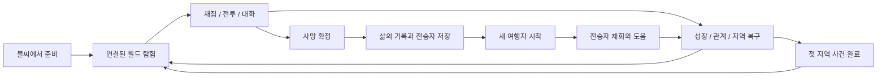

> 2026-10-27 최신 구현: [월드·자산 연동 보완 기록](WORLD_COMPLETION_KR.md)을 우선한다. 중심 간 5청크(약 20.21초), SQLite/V6 저장, 원거리 C++ 작업자, MD 계약 재적용, 별도 Blender 내보내기 및 J/C 애니메이션을 추가했다. 게임 빌드·실행 검수는 사용자가 진행한다.

> 2026-10-26 구현 확장: 마을·주민·이동·통신·주택의 현재 명세는 [일곱 마을 확장](SEVEN_TOWNS_KR.md)을 우선한다. 레벨 1 이후 진행은 [꺼진 종탑](LEVEL_TWO_KR.md), Blender 자산은 [제작 파이프라인](BLENDER_ASSET_PIPELINE_KR.md)을 참조한다. 이전의 세 소규모 거점/18명 설정은 7개 마을/기본 210명으로 대체되었다.

# 재의 계승 — 게임 마스터 기획서

> **추가 변경 1.2:** [가중치 전이·리젠·즉시 부활](SOCIETY_TRANSITIONS_KR.md)을 우선 적용한다. 직업별 고정 분기 대신 다섯 행동 점수로 선택하며, 사냥터 4자리/2초 리젠·일반 몬스터 5초 리젠·NPC 동일 ID 즉시 부활/3초 보호를 적용했다. 저장은 월드 V4/사회 V2다. 빌드·실행 검수 전이다.

> **2026-10-06 추가 명세:** [생활하는 오픈월드 프로토타입](LIVING_WORLD_PROTOTYPE_KR.md)을 먼저 읽는다. 사용자 추가 조건에 따라 마을·직업·목표·거래·약탈·PK·실시간 주민 갱신을 우선 구현했다. 아래의 장기 이야기/구조 계획은 계속 유지하되, NPC 무적·영구 자원 소진·대화 중 정지·저장 버전 관련 충돌은 추가 명세를 따른다. 소스 구현과 실제 실행 검수 완료는 구분한다.

> 문서 버전: 1.2 · 작성일: 2026-10-06  
> 기준 프로젝트: `C:\gamesogong\GSE` / `dev` / `BaseProject_SE\SimpleGame`  
> 목적: 현재 게임을 이어서 개발하여, 시작·성장·죽음·전승·재회·지역 회복·완료 후 탐험까지 이어지는 프로토타입을 완성한다.

## 1. 문서 사용 규칙

이 문서는 기존 게임을 폐기하는 새 기획이 아니다. 현재 코드의 규칙과 구현 자산을 출발점으로 삼는 개발 기준안이다. 여기서 **프로토타입 완성**은 핵심 경험을 처음부터 끝까지 플레이할 수 있는 상태이며, 상용 게임 전체 콘텐츠의 완성을 뜻하지 않는다.

| 표시 | 의미 |
|---|---|
| **요구사항** | 사용자가 명시한 방향. 변경 요청 없이는 유지한다. |
| **현재 구현** | 2026-10-06 소스에서 확인한 기능. 이번 문서 작성 중 실행 검증한 기능이라는 뜻은 아니다. |
| **완성안** | 이번 문서가 제안하는 프로토타입 개발 기준. 아직 구현되지 않은 내용이 포함된다. |
| **후속 확장** | 최종 게임 구조에 고려하지만 프로토타입 완료의 필수 조건은 아니다. |

이 문서에 추가한 이야기, 지명, 인물, 수치, 완료 조건은 **완성안**이다. 사용자에게 이미 확정받은 설정으로 취급하지 않는다. 구현 과정에서 변경하면 사유와 영향을 문서 끝의 변경 기록에 남긴다.

함께 읽을 문서:

- [최종 시스템·코드 구조](GAME_FINAL_ARCHITECTURE_KR.md): 책임, 소유권, 데이터, 저장, 렌더링, 단계별 이전.
- [프로토타입 구현·검수 계획](PROTOTYPE_DELIVERY_PLAN_KR.md): 작업 ID, 우선순위, 의존성, 완료 기준, 검수 시나리오.
- [렌더링 개선 리포트](RENDER_OPTIMIZATION_REPORT_KR.txt): 이미 추가된 배치·캐시·인스턴싱의 근거와 한계.

기획 내용이 충돌하면 본 마스터 기획서의 게임 규칙을 기준으로 판단하고, 기술 계약은 구조 문서, 구현 완료 여부는 검수 계획을 따른다. 기존 TXT는 구현 이력으로 보존한다. 특히 구형 동양풍 궁중·약사 기획과 현재 실행에서 제외된 `LevelOne.cpp`를 새 구현의 기준으로 사용하지 않는다.

## 2. 게임의 정의와 의미

**“내가 살아온 방식은, 내가 죽은 뒤에도 다른 사람의 삶으로 세계에 남는다.”**

플레이어는 무너진 중세 사회를 여행하는 이름 없는 생존자다. 물자를 모으고 위험을 제거하고 사람을 도우며 살아간다. 죽으면 그 삶의 행동과 감정의 흔적을 물려받은 NPC 한 명이 태어난다. 다음 여행자는 그 인물과 만나고, 이전에 되살린 쉼터와 관계를 바탕으로 더 먼 곳으로 향한다.

죽음은 캐릭터 한 명의 종결인 동시에 세계에 새로운 관계를 남기는 사건이다. 성장 수치뿐 아니라 **누구를 도왔는지, 어떤 감정을 표현했는지, 어디를 되살렸는지**가 플레이 결과가 된다. “등가교환”은 우선 죽음 하나와 생명 하나의 대응으로 표현한다. 생명의 가치를 점수로 환산하거나 현상의 모든 원인을 초반에 설명하지 않는다.

### 2.1 유지할 요구사항

| ID | 요구사항 | 게임에서 드러나는 방식 |
|---|---|---|
| R01 | 2.5D RPG | 사선 고정 카메라, 평면 이동, 높이와 앞뒤 관계가 보이는 픽셀 모델 |
| R02 | 중세 암흑시대, 암울함 속의 희망 | 폐허·불신·부족한 물자와 대비되는 불씨·생활·신뢰 |
| R03 | 자유롭게 이동하는 오픈월드 | 지역 이동키 없이 연결된 지형을 걸어서 이동 |
| R04 | 정해진 끝 없이 확장되는 월드 | 시드 기반 청크 생성과 주변 지역 스트리밍 |
| R05 | 플레이어의 죽음 하나가 NPC 한 명 생성 | LifeId별 단일 전승 기록과 지속되는 NPC |
| R06 | 성격·패턴·감정의 계승 | 행동 기록으로 정한 성향에 따라 NPC 행동과 대사 변화 |
| R07 | 만들어진 재미의 지속 | 전승자·관계·지역 복구·성장·사건 결과가 재시작 후에도 남음 |
| R08 | Actor / SceneGraph 중심 | 월드 오브젝트의 공통 생명주기와 계층 관리 |
| R09 | 재사용 가능한 메시·외부 셰이더·후처리 | 파일 캐시, 인스턴스 배치, HDR/Bloom/비넷/가장자리 블러 |
| R10 | 성능 분석의 지속 | 실행 세션별 로그와 비교 리포트 |
| R11 | 마을을 거점으로 하는 NPC 사회 | 기존 크기의 월드에 마을과 시장, 사냥터 |
| R12 | 직업·목표·약탈 성향 | 체력·재산·깨달음에 따른 사냥/약탈/거래/수련 |
| R13 | PK와 계속되는 주민 상태 갱신 | 영구 사망·재산 이전, 화면 밖 주민 시뮬레이션 |

“무한”은 무한한 데이터를 한 번에 생성하거나 모든 NPC를 동시에 시뮬레이션한다는 뜻이 아니다. 설계상 임의의 지도 끝을 두지 않고, 실제 한도는 좌표 표현·메모리·저장 장치가 결정한다. 장기 운용을 위한 저장 분할은 구조 문서에서 구분한다.

### 2.2 플랫폼과 기본 제공 범위 — 완성안

- Windows PC, 싱글플레이, 키보드 조작, 한국어 UI를 기준으로 한다.
- 현재 C++17 / OpenGL 3.3 / freeglut 기반을 유지한다.
- 온라인 서버나 생성형 AI 연결 없이도 핵심 게임 전체를 플레이할 수 있어야 한다.
- 첫 이야기의 목표 플레이 시간은 **약 25~40분**이다. 측정된 시간이 아니라 콘텐츠 배치 기준이다.
- 첫 이야기가 끝나도 월드는 닫히지 않고 자유 탐험을 계속한다.

## 3. 현재 구현과 완성까지의 차이

| 영역 | 현재 구현 | 완성을 위해 추가/보강할 것 |
|---|---|---|
| 월드 | 768 단위 청크, 주변 5×5 유지, 로컬 원점 이동 | 첫 지역의 고정 의미 장소, 연결성 검사, 경계 스트리밍 검수 |
| 캐릭터 | 플레이어·적·주민·전승자 2.5D 표현 | 역할별 판독성, 상태 피드백, 시작/완료 연출 |
| 전투 | 사거리 360 자동 조준 발사체, 근접 적의 예고 공격 | 원거리 적 1종, 보스 1종, 타겟 선택 안정화 |
| 파밍·성장 | 채집, XP, 레벨, 무기 강화, 4종 아이템 | 이야기 진행과 연결, 획득 안내, 반복 보상 방지 정리 |
| 전승 | 사망 시 성향/감정 NPC 생성, 재시작, 지원 행동 | 첫 재회의 안내, 원인 설명, 안전한 탄생 위치, 악용 방지 |
| 관계·쉼터 | 나눔, 감정 선택, 불씨 복구/휴식 | 이름 있는 주민, 단계별 대사, 회복 전후 지역 변화 |
| 목표 | 레벨 1 학습 단계 표시 | 사건 상태 머신, 첫 이야기 종료 조건, 완료 후 플레이 |
| UI | HUD, 기록, 대화, 사망, 수동 저장 | 시작 메뉴, 일시정지, 설정, 목표 목록, 복구 안내 |
| 저장 | V1/V2 읽기, 검증, 원자적 교체, 중복 전승 방지 | 신규 사건 데이터 버전, 백업/이전, 저장 오류 UX |
| 렌더링 | 순서 보존 배치, TBO 아틀라스, 파일 캐시, 인스턴싱 | 사용자 실행에서 정확성·성능 검증, 로그 기준선 확보 |
| 오디오 | 이번 소스 확인에서 완성된 재생 시스템을 확인하지 못함 | 최소 환경음·위험·피격·전승·복구 피드백 |

현재 구조에 대한 근거: `DarkAgeGame.*`, `WorldTypes.h`, `WorldActors.h`, `SceneGraph.*`, `DarkAgeProgression.cpp`, `DarkAgeSave.cpp`, `DarkAgeRenderer.cpp`, `RenderBatch.*`, `DiskMeshCache.*`, `RenderProfiler.*`.

## 4. 핵심 플레이 순환

짧은 보상은 아이템·성장, 중간 보상은 안전한 이동로·주민의 반응, 긴 보상은 전승자·지역 복구·이야기 결과로 구성한다. 죽지 않아도 탐험과 사건 진행은 가능해야 한다. 전승은 실패 경험을 이어주는 구조이며, 무조건 죽어야 좋은 보상을 받는 숙제로 만들지 않는다.

## 5. 첫 이야기: 다시 켜지는 종탑 — 완성안

### 5.1 공간과 인물

중심 지역의 이름은 **재빛 골짜기**로 제안한다. 최초 시드가 달라도 중요한 장소의 관계는 같고, 주변 지형·장식·자원 배치는 시드에 따라 달라진다.

| 장소 | 기준 청크 | 기능 | 영구 변화 |
|---|---|---|---|
| 마지막 불씨 | (0, 0) | 시작, 기본 조작, 재시작, 안내 NPC | 시작 시 점화된 쉼터 |
| 메마른 들판 | (1, 0) | 채집·성장·전투 학습, 첫 복구 | 복구한 불씨, 주민 대사 변화 |
| 기록의 돌무덤 | (0, 1) | 전승 설명, 기록 열람, 선택적 의식 | 방문·설명 확인 기록 |
| 침묵한 수도원 | (2, 1) | 보스와 종탑 복구, 첫 이야기 결말 | 위협 제거, 불씨와 창문 불빛, 종소리 |

좌표는 구현 초안이며 이동 시간 검수 후 변경할 수 있다. 장소 접근을 투명벽이나 순간이동으로 제한하지 않는다. 모든 필수 장소는 서로 연결된 도로로 갈 수 있어야 한다.

| 인물 | 역할 | 최소 대화 상태 |
|---|---|---|
| 마라 — 불씨 지기 | 현재 목표와 쉼터 규칙 안내 | 첫 만남 / 들판 복구 / 첫 재회 / 종탑 복구 |
| 오렌 — 들판의 주민 | 파밍과 나눔의 의미, 지역 변화 전달 | 불안 / 도움받음 / 불씨 복구 / 위협 제거 |
| 세라 — 기록을 지키는 사람 | 전승 현상을 설명하고 삶의 기록 연결 | 미전승 / 전승 후 / 재회 후 / 이야기 완료 |

인명과 지명은 임시 창작안이다. NPC는 플레이어에게 같은 설명을 매번 반복하지 않고, 저장된 사건 상태에 맞는 짧은 대사를 우선한다.

### 5.2 플레이 흐름과 예상 소요

| 단계 | 목표 시간 | 행동 | 확인할 감정/학습 |
|---|---:|---|---|
| 1. 깨어남 | 0~3분 | 이동, 마라와 대화, 주변 탐색 | 불씨 주변은 안전하며 바깥은 위험함 |
| 2. 살아갈 준비 | 3~10분 | 채집, 자동 조준 공격, 아이템 습득, Lv.2 | 조작과 성장의 즉각적인 보상 |
| 3. 첫 회복 | 10~15분 | 들판 불씨 복구, 주민과 나눔 | 행동이 장소와 관계에 남음 |
| 4. 삶의 흔적 | 진행 중 병행 | 죽음 이후 재시작·재회 또는 돌무덤에서 설명 확인 | 죽음이 세계의 관계를 바꿈 |
| 5. 종지기의 위협 | 15~30분 | 원거리 적과 보스 예고를 읽고 수도원 위협 제거 | 성장·이동·지원의 의미 |
| 6. 다시 울리는 종 | 25~40분 | 수도원 불씨 복구, 주민 반응, 완료 기록 | 암울한 세계에서 작지만 지속되는 희망 |

사망 횟수 때문에 목표 시간에 맞추도록 강제하지 않는다. 빠른 플레이어는 사망 없이 첫 이야기를 끝낼 수 있다. **콘텐츠 완료**와 **개발 검수에서 전승 기능을 확인하는 것**은 별개의 조건이다.

### 5.3 목표 상태와 순서 변경 처리

| ID | 목표 | 완료 판정 | 선행/예외 |
|---|---|---|---|
| Q01 | 불씨 지기와 첫 대화 | 최초 안내 대화 종료 | 이후 반복 대화는 보상 없음 |
| Q02 | 첫 채집 | 채집 성공 1회 | 대화 전에 해도 소급 인정 |
| Q03 | 위협에 맞서기 | 플레이어 기여가 있는 적 처치 1회 | 지원 NPC의 마무리 공격도 기여 규칙 적용 |
| Q04 | 성장과 아이템 익히기 | Lv.2 이상, 4종 아이템 각각 1회 습득 | 기존 lessons/itemsSeen 기록을 활용 |
| Q05 | 들판의 불씨 복구 | 지정 불씨를 복구한 RegionState | 물자 부족 시 새 채집 지점 안내 |
| Q06 | 전승의 의미 알기 | 세라의 설명 확인 | 죽음·재회는 선택 분기, 기본 진행을 막지 않음 |
| Q07 | 종지기 격파 | 고유 BossId의 처치 커밋 | 먼저 처치해도 인정; 반복 지급 금지 |
| Q08 | 종탑의 불씨 복구 | Q07 완료 + 지정 불씨 복구 | 비용 3, 조건 미달 시 이유 표시 |
| Q09 | 남겨진 희망 확인 | Q05/Q07/Q08 완료 후 마라의 결말 대화 | 첫 이야기 완료를 영구 기록 |
| QS01 | 남겨진 사람과 재회 | 전승 NPC와 최초 대화 | 선택 목표, 별도 기록과 연출 제공 |

Q02~Q04는 학습 체크리스트이고 Q09를 막는 수집 과제로 사용하지 않는다. Q06 역시 세계관 안내이며, 강제 사망을 유도하는 잠금 조건이 아니다. 사건 상태는 `미노출 → 진행 가능 → 진행 중 → 완료`로 저장하고, 완료 판단은 UI 문구가 아니라 실제 게임 상태/이벤트를 사용한다.

## 6. 이동·카메라·상호작용

- 방향키로 이동한다. 사선 카메라는 유지하고 기본 회전 기능은 추가하지 않는다.
- 대각선 이동의 길이는 정규화하며, 입력 방향과 화면상 방향이 일치해야 한다.
- 건물에 가린 플레이어는 기존 가림 투명도를 활용해 읽을 수 있도록 한다.
- E는 가까운 대상과 상호작용한다. 지역 전환 키로 사용하지 않는다.
- G는 물자를 나누고, Space를 누르는 동안 사거리·시야 조건에 맞는 적에게 발사한다.
- 대화 1/2/3, Tab 기록, R 다음 삶, F8 저장을 유지한다.
- Esc는 대화/기록 등 최상위 창을 닫고, 열린 창이 없으면 일시정지 메뉴를 연다.
- 상호작용 가능 대상이 여럿이면 거리 우선, 동률은 안정적인 ID 순서로 선택한다. 장애물 뒤 대상은 제외한다.
- 대화·일시정지·사망 전환 중에는 이동/공격 입력을 지운다. Alt+Tab 복귀 후 눌림 상태가 남지 않아야 한다.

## 7. 전투와 성장

### 7.1 플레이어 규칙

자동 조준은 조작 부담을 낮추고, 위험 판단은 이동·거리·장애물·공격 예고로 만든다. 사거리 밖 대상에게 발사하거나 벽을 관통해 맞히지 않는다. 같은 거리에 적이 여럿일 때 타겟이 매 프레임 흔들리지 않도록 기존 유효 타겟을 우선하고, 무효화 시 다시 찾는 규칙을 완성안으로 추가한다.

현재 성장 수치를 첫 밸런싱의 기준선으로 유지한다.

| 항목 | 현재 코드 기준 |
|---|---|
| 최대 체력 | `100 + (레벨 - 1) × 12` |
| 발사 피해 | `18 + (레벨 - 1) × 3 + 무기강화 × 4` |
| 발사 간격 | `max(0.18, 0.65 / (1 + (레벨 - 1) × 0.065 + 무기강화 × 0.04))`초 |
| 공격 사거리 | 360 |
| 다음 레벨 필요 XP | `35 + (레벨 - 1) × 15` |
| 최대 레벨 / 강화 | 30 / 20 |
| 채집 / 일반 적 처치 XP | 8 / 12 |
| XP 드롭 | 15 |
| 기본 / 자석 습득 범위 | 100 / 320 |
| 회복 드롭 | 최대 체력의 35% |
| 자석 | 20초 추가, 합산 최대 60초 |

수치는 `BalanceConfig`로 옮기되, 데이터화 자체로 값을 바꾸지 않는다. 첫 보스의 권장 성장 범위는 Lv.3~5/강화 +1~3으로 제안하지만 입장 조건으로 강제하지 않는다.

### 7.2 적 구성 — 완성안

| 유형 | 역할 | 시작 수치/행동 제안 |
|---|---|---|
| 굶주린 추적자 | 근접 예고 회피 학습 | 현재 적 기반: 체력 48, 피해 24, 예고 0.65초, 재공격 대기 1.2초 |
| 재를 던지는 자 | 사거리와 엄폐 학습 | 체력 36, 피해 14, 발사 간격 1.6초, 예고 0.8초, 사거리 300 |
| 종지기 | 첫 이야기 보스 | 체력 420, 2가지 공격, HP 50%에서 속도 변화 |

원거리 적은 발사 시점의 플레이어 위치를 조준하며 발사체가 무한 추적하지 않는다. 발사체 속도 초안은 180, 사거리는 300이다. 적의 색상과 외형, 공격 예고를 함께 구분하고 색상만으로 위험을 전달하지 않는다.

보스 상태는 `대기 → 예고 → 공격 → 회복 → 재판단`이다. 공격 A는 가까운 전방 강타(예고 1.0초, 피해 28), 공격 B는 세 방향 재 발사체(예고 1.2초, 각 피해 16)로 시작한다. 2단계에서도 예고를 없애지 않고 회복 시간을 줄인다. 같은 발사체가 플레이어에게 반복 피해를 주지 않도록 히트 소비/무적 시간을 적용한다.

보스 구역은 월드에 연결된 넓은 마당이다. 별도 로딩이나 문 잠금으로 가두지 않는다. 충분히 멀어지면 보스는 귀환하고 체력을 회복한다. 이 초기화 규칙은 첫 접근 안내와 UI에 드러낸다. 처치된 보스는 재생성하지 않는다.

보스 보상 초안: XP 60, 물자 3, 기록 항목 1개, 수도원 불씨 복구 조건 해제. `BossId + RewardId`로 단 한 번 지급한다. 지원 NPC가 마무리해도 플레이어의 유효 피해 기여가 있으면 목표를 인정한다.

## 8. 파밍·아이템·자원 경제

프로토타입의 소모 자원은 현재의 **물자 1종**을 유지한다. 강화·회복·XP·자석 드롭을 유지하고, 별도의 대형 인벤토리/제작 트리를 필수 범위에 넣지 않는다.

| 자원 흐름 | 규칙 |
|---|---|
| 시작 물자 | 첫 세계 시작 시 3개 |
| 채집/일반 적 | 현재 물자 및 드롭 규칙 유지, 장소별 수령 이력 저장 |
| 불씨 복구 | 물자 3개 소비, 영구 복구 |
| 나눔 | 물자 1개, 같은 상대에게 한 삶에서 1회 관계 반영 |
| 물자 상한 | 현재 상한 99 유지; 가득 찼을 때 안내 |
| 아이템 습득 | 가까워지면 자동 접근/습득, 장애물 관통 금지 |
| 드롭 보존 | 미습득 드롭은 재방문·재실행 시 복원, 수령 보상은 재지급하지 않음 |

### 8.1 죽음으로 자원이 늘어나는 문제 방지 — 변경 제안

현재는 다음 삶마다 물자 3개를 새로 지급한다. 이를 반복하면 나눔 자원을 죽음으로 계속 만들 수 있으므로, 완성안에서는 **물자를 세계 공유 비축량으로 유지하고 사망 시 추가 지급하지 않는다.** 최초 시작 지원만 1회 지급한다. 레벨·XP·강화의 유지 원칙은 그대로 따른다.

새 삶은 최대 체력으로 시작하고 빈 물자 때문에 이동/기본 공격이 막히지 않는다. 물자가 없다면 안전 경로 주변의 미채집 지점이나 새 청크로 이동할 수 있어야 한다. 이 변경은 저장 버전 이전과 UI 문구 변경을 함께 수행하며 기존 저장에서 물자를 임의로 삭제하지 않는다.

새로운 지역은 자원을 제공하지만, 이미 해결한 지역의 동일 보상은 재실행·청크 경계 왕복으로 생성되지 않는다. 기존 채집 지점은 재생하지 않는다. 생활형 추가 명세의 사냥 대상은 2초, 일반 적은 5초 리젠으로 경제 공급을 유지한다.

## 9. 죽음·전승·재회

### 9.1 한 죽음, 한 생명

1. 체력 0을 한 번만 사망으로 확정하고 조작/전투를 정지한다.
2. 해당 `LifeId`의 행동 기록과 마지막 위치를 고정한다.
3. 전승 프로필을 확정하고 `LifeId → HeirId`를 한 번만 등록한다.
4. 사망 상태와 NPC 생성 결과를 같은 저장 트랜잭션에 기록한다.
5. 저장 성공 후 R로 다음 삶을 시작할 수 있다.
6. 새 여행자는 마지막 점화된 불씨에서 시작한다.
7. 전승자는 월드 기록에 남고, 해당 지역이 활성화되면 Actor로 복원된다.

NPC의 로딩/언로딩은 탄생/죽음이 아니다. 같은 LifeId가 다시 처리되어도 새 NPC를 추가하지 않는다. 저장에 실패하면 원래 기록을 보존하고 재시도 안내를 제공한다.

### 9.2 계승할 정보

| 분류 | 프로토타입에 사용할 정보 | 사용처 |
|---|---|---|
| 행동 | 이동 거리, 적 처치, 나눔, 휴식 | 성향 설명, 배회/지원 행동 |
| 감정 | 희망·두려움·분노의 선택/사건 횟수 | 대사 어조와 기록 |
| 기원 | LifeId, 사망 위치, 출생 위치, 생성 버전 | 재회 안내, 중복 방지, 이전 |
| 관계 | 출생 후 쌓인 신뢰와 마지막 교류 삶 | 치료 조건, 주민의 반응 |

여기서 감정은 **게임 속 캐릭터가 표현한 선택**이다. 실제 사용자의 심리를 감지하거나 판정하지 않는다. 최초 프로필은 변경하지 않고, NPC가 태어난 뒤의 관계 변화는 별도 상태로 저장한다.

### 9.3 성향과 행동

프로토타입은 현재의 명시적 분류를 유지하며, 기록 화면에 판정 근거를 보여준다.

| 우선순위 | 현재 분류 조건 | 성향 | 행동 |
|---:|---|---|---|
| 1 | 나눔 2회 이상 | 나누는 사람 | 신뢰 형성 후 가까운 플레이어 치료 |
| 2 | 위 조건 아님 + 처치 2회 이상 | 지키는 사람 | 주변 위협에 공격 지원 |
| 3 | 위 조건 아님 + 두려움>희망 또는 휴식 3회 이상 | 불씨를 찾는 사람 | 쉼터 주변 생활 |
| 4 | 그 외 | 길을 걷는 사람 | 더 넓게 배회 |

여러 행동을 한 경우 하나의 이름만으로 인물을 설명하지 않는다. 주 성향 외에 처치/나눔/여행 기록을 함께 보여준다. 가중치 기반 복합 성격과 시간대별 일과는 후속 확장이다.

전승자의 출생 지점은 사망 위치 근처의 접근 가능한 지점을 우선한다. 장애물·보스 공격 영역·끊긴 도로에 갇히면 같은 청크의 안전 후보, 그다음 인접 청크의 쉼터 순으로 배치한다. 사망 흔적의 원래 위치와 안전하게 배치된 NPC 위치를 각각 보존한다.

첫 재회에서는 기원이 된 삶의 대표 행동 1개와 짧은 대사를 보여준다. 예: “제2의 삶에서 두 번 나누었던 물자가, 누군가를 돌보는 습관으로 남았습니다.” 관계가 높아졌다고 원래 삶의 사실을 다시 작성하지 않는다.

### 9.4 선택적 전승 체험

죽지 않은 플레이어도 전승을 체험하려면 돌무덤의 **삶을 내려놓는 의식**을 선택할 수 있게 한다. 이는 P1 후속 콘텐츠로, 첫 프로토타입 P0 완료에는 필수가 아니다. 효과를 설명하고 별도 확인을 받은 뒤 일반 사망과 동일한 트랜잭션을 사용한다. 자동 사망 이벤트나 숨겨진 즉사 함정으로 설명을 대신하지 않는다.

최신 프로토타입 조건으로 주민/전승자 PK와 동일 ID 즉시 부활을 적용한다. 최초 탄생 기록은 보존하며 NPC 사망이 전승자를 무한 생성하지 않는다. 노화·세대 갈등은 후속 확장이다.

## 10. 월드의 지속과 변화

| 상태 | 사망 후 | 청크 언로드 후 | 재실행 후 |
|---|---|---|---|
| 지형 시드·생성 버전 | 유지 | 재현 | 유지 |
| 복구한 불씨·사건 완료 | 유지 | 저장 | 유지 |
| 레벨·XP·강화·공유 물자 | 유지 | 유지 | 유지 |
| 전승 프로필·NPC 관계 | 유지 | NPC Actor만 해제 | 유지 |
| 수령한 보상/처치한 고유 적 | 유지 | 중복 방지 | 유지 |
| 미습득 드롭 | 유지 | 상태 저장 | 복원 |
| 플레이어 임시 발사체 | 제거 | 관련 범위 종료 시 제거 | 복원하지 않음 |
| 일반 적의 일시 체력/추격 위치 | 필요 시 초기화 | 현재처럼 초기화 | 초기화 |
| 보스 전투 중 체력 | 재도전 시 초기화 | 전투 종료 처리 | 초기화 |
| 실제 보스 처치 이력 | 유지 | 유지 | 유지 |
| 자석 잔여 시간 | 현재 저장 정책 유지 | 유지 | 남은 시간부터 재개 |

완료한 지역의 불씨를 다시 끄거나 전승자를 성능 문제로 몰래 지우지 않는다. 먼 지역의 NPC는 상세 업데이트를 멈추고 기록만 보존한다. “계속 살아간다”는 설정과 “모든 지역을 매 프레임 계산한다”는 기술 선택을 구분한다.

랜덤 생성은 도로/쉼터/필수 진입점을 먼저 확보한 뒤 장애물과 장식을 배치한다. 실패 시 제한 횟수 재배치 후 안전한 기본 배치를 사용한다. 연결성 검사의 통과 여부와 재시도 횟수는 개발 로그에 남긴다.

## 11. 화면·소리·접근성

- 현재 픽셀 볼륨 캐릭터와 중세 모델을 유지한다. 동양풍 궁중 모델로 되돌리지 않는다.
- 회색·흙색·탁한 녹색을 기본으로 하고, 복구한 장소에는 따뜻한 창문과 모닥불 빛을 사용한다.
- 자체 발광은 emissive 출력과 Bloom으로 표현하고 거대한 반투명 원으로 빛을 덧칠하지 않는다.
- 위협 예고, 발사체, 플레이어 실루엣이 후처리에 묻히지 않아야 한다.
- HUD에는 체력, 성장, 물자, 현재 목표, 저장 상태를 우선한다. 상세 프로파일링은 기본 게임 화면과 분리한다.
- 기록 화면은 삶/전승자/관계/완료 사건을 탭으로 나눌 수 있게 확장한다. 목록은 페이지/스크롤로 모든 기록에 접근 가능해야 한다.
- 최초 학습 안내는 완료하면 짧게 접힌다. 지역 이름을 화면 상단에 항상 크게 고정하지 않는다.
- 최소 소리: 이동/채집/발사/피격/위험 예고/점화/전승/종소리와 낮은 환경음. 장치 오류나 음소거 상태에서도 진행 가능해야 한다.
- 전체 음량과 효과음 조절, 후처리 강도/켜기·끄기, 읽기 쉬운 대화 텍스트를 제공한다.

## 12. 시작·종료·실패 처리

시작 화면은 `계속하기 / 새 세계 / 설정 / 종료`를 제공한다. 기존 기록이 있을 때 새 세계를 선택하면 교체 사실을 알리고 백업 또는 별도 슬롯을 만든다. 프로필 데이터가 손상되면 조용히 새 게임을 덮어쓰지 않는다.

일시정지에서는 목표·조작·설정·저장 상태를 확인하고 제목 화면으로 돌아갈 수 있다. 저장 실패 시 “저장되지 않은 변경이 있음”과 재시도 수단을 보여준다. 강제 종료를 정상 저장으로 표시하지 않는다.

첫 이야기 완료 화면은 살아온 삶 수, 만난 전승자, 복구한 장소, 완료한 주요 사건을 보여준다. `탐험 계속`으로 돌아가면 같은 월드와 기록을 사용한다. 월드 초기화나 강제 크레딧 종료는 하지 않는다.

## 13. 프로토타입 필수 범위와 후속 확장

**필수:** 현재 게임 순환, 4개 의미 장소, 주민 3명, 일반 적 2종, 보스 1종, 첫 이야기 목표, 전승·재회, 지속되는 복구, 기본 메뉴/오디오/설정, 저장 이전, 성능 로그, 완료 후 탐험.

**후속:** 대규모 제작/장비 인벤토리, 직업 트리, 동료 지휘 UI, NPC 노화/사망, 왕국 정치, 날씨·계절, 던전 인스턴스, 멀티플레이, 모딩, 실시간 생성형 AI 대화, 원거리 사회 시뮬레이션.

생성형 AI 대화는 나중에 추가할 수 있는 확장 지점으로 둔다. 확정된 사건/프로필을 입력으로 표현만 확장하고, 보상·사망·NPC 생성·저장 사실은 게임 시스템이 결정한다. 시간 초과·서비스 중단 시 저장된 규칙 기반 대사를 사용한다.

## 14. 완료를 판단하는 질문

1. 설명 없이 시작해도 이동·채집·공격·복구를 알아갈 수 있는가?
2. 죽은 삶의 행동과 새 NPC의 행동 사이의 관계를 플레이어가 설명할 수 있는가?
3. 재실행 후에도 복구와 관계가 남아 “해놓은 일”이 의미가 있는가?
4. 첫 이야기가 끝났음을 알 수 있고, 계속 탐험할 이유가 남는가?
5. 기록/캐시/로그가 커져도 원인을 파악하고 데이터 손실 없이 대응할 수 있는가?

각 질문의 구체적인 통과 조건은 [구현·검수 계획](PROTOTYPE_DELIVERY_PLAN_KR.md)에 연결한다. 현재 코드가 존재한다는 사실만으로 완료 처리하지 않는다.

## 15. 변경 기록

| 날짜 | 버전 | 변경 | 근거 |
|---|---|---|---|
| 2026-10-06 | 1.0 | 현재 중세 전승 RPG 기반의 완성안, 첫 이야기, 지속 규칙, 범위 정의 | 사용자 요청 및 현재 소스 확인 |

다음 변경에는 `요구사항 ID / 변경 전후 / 저장·콘텐츠·성능 영향 / 검수 항목`을 함께 기록한다.
