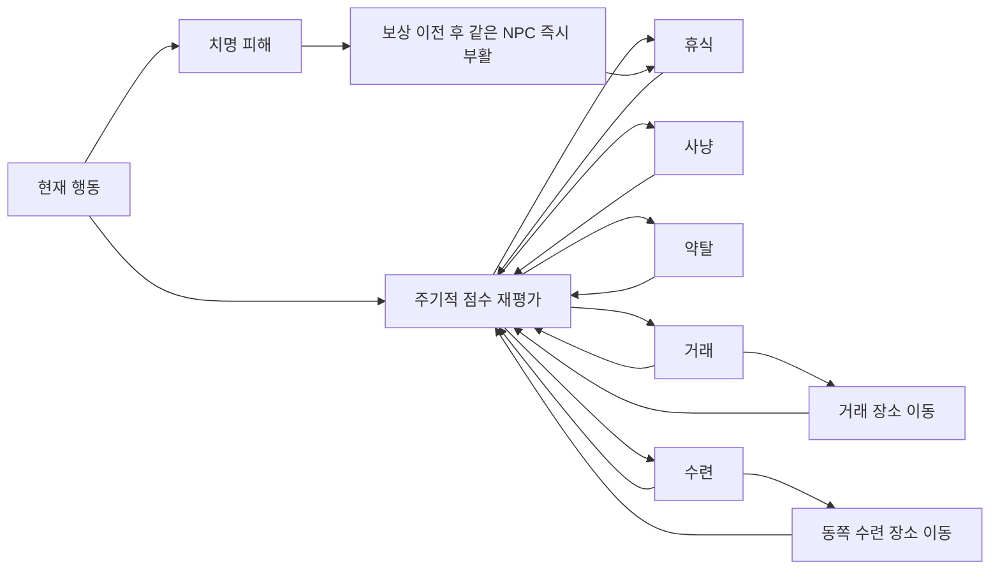

# NPC 가중치 전이·사냥 리젠·즉시 부활

> 2026-10-13 · 생활형 프로토타입 추가 명세 1.3  
> 소스 구현 상태. 빌드·게임 실행·시각 검수는 사용자 담당이며 아직 통과로 판정하지 않았다.

> 군집·중복 배치 보완은 [NPC·몬스터 분산 수정 보고서](POPULATION_SPACING_FIX_KR.md)를 함께 따른다. 사냥터 전멸 직후의 강제 리젠은 제거했고, 2초 대기와 안전한 배치 공간을 모두 확보한 뒤 리젠한다.

## 변경 목적

기존 `약탈 성향 ≥ 0.6`, `사냥꾼이면 사냥` 같은 분기 대신 **실행 가능한 행동을 모두 평가하고 가장 높은 점수의 행동을 선택**한다. 직업은 행동을 제한하는 벽이 아니라 기본 선호도가 된다. NPC 사망으로 인구가 줄고 사냥 대상이 사라져 시뮬레이션이 멈추는 문제도 프로토타입 규칙으로 해소한다.

## 1. 가중치와 전이

평가 후보는 휴식·사냥·약탈·거래·수련 다섯 가지다. 어느 행동에서든 다른 후보로 직접 재평가할 수 있다. 광장 이동 중의 `귀환`은 선택한 행동을 실행하기 위한 이동 상태다. 선택한 의도와 화면에 표시되는 현재 행동을 분리한다.

### 직업별 기본 점수

| 직업 | 휴식 | 사냥 | 약탈 | 거래 | 수련 |
|---|---:|---:|---:|---:|---:|
| 사냥꾼 | 4 | 30 | 0 | 16 | 8 |
| 약탈자 | 6 | 16 | 18 | 14 | 8 |
| 상인 | 5 | 12 | -6 | 34 | 10 |
| 구도자 | 6 | 14 | -6 | 14 | 34 |

추가 점수:

- 체력 부족: 휴식 우선도 상승, 사냥/약탈 위험 감점.
- 돈 부족: 사냥·약탈·거래 우선도 상승.
- 물자 부족: 사냥 우선도 상승. 보유 물자는 거래·수련에 영향을 준다.
- 강한 몸 목표: 휴식 +14, 사냥 +10, 수련 +12.
- 부 목표: 사냥 +10, 약탈 +8, 거래 +16.
- 깨달음 목표: 사냥 +4, 수련 +20.
- 약탈 점수는 `raidWeight × 95 - 35`를 연속적으로 반영한다. 0.6의 행동 활성화 임계값은 제거했다.
- 같은 행동을 유지하면 처음에는 +6을 줘 불필요한 전환을 줄이고, 8초 이상 지속하면 최대 30을 감점해 다른 행동을 재검토한다.
- NPC ID와 세계 시간으로 만든 작은 선호 변화(±4)를 더한다. 매 프레임 무작위 추첨하지 않는다.

평가는 약 1.25~1.55초 간격이다. 체력이 30% 미만이거나 부활 보호 중이면 휴식 점수 300으로 우선한다. 약탈 대기시간과 거래/수련 대기시간을 분리하여, 약탈 후 24초 동안 모든 행동이 멈추지 않게 한다. 사냥 성공, 상대 소멸, 거래 완료 뒤에는 다음 틱에 재평가할 수 있다.

### 실행 가능 조건

대상이 없거나 재고·돈·쿨타임 조건이 안 맞는 행동은 점수 `-1000` 이하로 제외한다. 최고 점수라도 실행 불가능한 행동을 선택하지 않는다.

- 사냥: 배치가 완료된 살아 있는 대상, 2명 미만의 다른 예약자, 물자 적재 여유가 필요하다. 행동 점수 평가만으로는 사냥 자리를 예약하지 않는다.
- 약탈: 약탈 대기시간이 끝나고, 보호 중이 아닌 재산 보유 주민 또는 시야가 열린 근거리 플레이어가 있어야 한다. 약탈자끼리도 재산에 따라 대상이 될 수 있다.
- 거래: 재고·동전 조건에 맞는 상대가 있어야 한다. 계획할 때는 시장 밖의 상대도 고려하여 시장 복귀가 가능하게 하고, 실제 교환은 두 사람 모두 광장에 도착했을 때만 수행한다. 상인 자신도 구매/판매를 능동적으로 수행한다.
- 수련: 모든 직업이 선택할 수 있다. 물자를 사용하면 회복하고 강한 몸 목표의 최대 체력이 성장한다.
- 공격받은 NPC의 가까운 반격은 우선 처리하되, 체력 30% 미만이면 회복 판단이 우선한다.

예상 전이 예시는 `사냥 → 물자 누적 → 거래 → 물자 부족 → 사냥`, `약탈 → 약탈 대기 → 사냥/거래/수련`, `상인 → 재고 부족·거래 상대 없음 → 사냥`, `어느 직업이든 부상 → 휴식`이다. 모든 NPC가 같은 시간에 모든 행동을 수행한다는 보장은 아니며, 조건과 점수에 따라 달라진다.

## 2. 사냥터와 일반 몬스터 리젠

| 대상 | 변경 후 규칙 |
|---|---|
| 주민 사냥터 | 거점당 4슬롯 유지, 처치 후 최소 2초; 자리가 점유되어 있으면 추가 대기 |
| 사냥터가 모두 비었을 때 | 강제 최소 수량 복구 제거. 모든 슬롯이 자신의 대기시간과 배치 검사를 지킴 |
| 주민 대상 재탐색 | 거리·예약 인원·현재 대상 선호를 함께 평가. 대상당 최대 2명, 서로 다른 접근 위치 사용 |
| 몬스터 위치 | 남쪽의 분리된 4영역. 영역 안 8개 후보를 순환하며 플레이어·주민·일반 몬스터와 겹치는 자리 회피 |
| 최초 생성·저장 로드 | 리젠과 같은 배치 검사 사용. 배치가 미정인 사냥터는 숨기고 자동 조준·공격·주민 사냥에서 제외 |
| 리젠 직후 사냥터 공격 | 1초 공격 대기 |
| 기존 일반 몬스터 | 일회성 처치에서 5초 리젠으로 변경, 초기 체력 48과 공격 대기 1초 |
| 일반 몬스터 추적 | 생성 위치를 중심으로 활동. 대상을 잃거나 보호된 마을로 피하면 귀환하고 주변 캐릭터와 간격 확보 |
| 생성 수 제한 | 일반 몬스터는 청크당 2슬롯, 사냥터는 거점당 4슬롯. 같은 종류·청크·슬롯의 Actor 생성은 재사용 |
| 화면 밖 | 리젠 타이머도 계속 진행. 다시 로딩할 때 현재 기록에서 Actor 생성 |

기존 일반 몬스터의 드롭은 리젠 때 정리한다. 이전 드롭 Actor 제거 → 수령 비트 초기화 → 처치 비트 초기화 → 새 몬스터 생성 순서로 처리한다. 같은 슬롯의 이전 드롭이 다음 처치의 수령 이력을 잘못 차감하거나 중복 보상을 만드는 것을 막는다. **일반 몬스터의 미습득 드롭은 5초 안에 챙기는 프로토타입 정책**이다. 영구 드롭·별도 전리품 세대 ID는 후속 확장이다.

채집 식물은 이번 변경으로 재생성하지 않는다. NPC/플레이어의 새 사냥 보상은 각 처치에서 한 번만 지급한다.

## 3. NPC 즉시 부활

사망 처리는 `치명 피해 확정 → 남은 재산 이전 → 동일 기록의 체력·위치 복구`를 한 호출 안에서 수행한다. 주민은 거점 서쪽 휴식 공간의 덜 붐비는 자리에서 최대 체력으로 즉시 다시 나타나고 3초간 피해와 자동 조준 대상 선택에서 보호된다. 적대·타겟·공격 타이머를 지워 이전 전투를 그대로 이어서 맞지 않게 한다.

유지하는 값:

- NPC ID, 원래 삶의 ID, 직업, 목표, 약탈 가중치.
- 최대 체력, 깨달음, 나눔·대화 이력, 전승 관계.
- 전리품 이전 후 남아 있는 동전·물자.

새 NPC를 생성하거나 시작 자산을 다시 주지 않는다. 따라서 주민 사망만으로 총 NPC 수가 줄지 않고, 부활을 반복해 시작 자산을 복제할 수도 없다. NPC의 부활 횟수를 저장한다. NPC의 죽음은 플레이어의 새 삶이나 추가 전승자를 만들지 않는다.

기존 저장에서 이미 죽어 있던 주민도 로딩 시 같은 ID로 복구한다. 플레이어의 죽음이 새 전승 NPC 한 명을 추가하는 기존 규칙은 유지하므로 인구는 **주민 사망 때문에 감소하지 않되, 플레이어 전승으로 증가할 수 있다.**

## 4. 저장과 구조

- 월드 저장: `ASHEN_WORLD_V4`. Region별 일반 몬스터 2자리 리젠 타이머 추가.
- 사회 저장: `SOCIETY_V2`. 선택 의도, 약탈 대기시간, 부활 보호, 부활 횟수 추가.
- V1/V2/V3 월드와 SOCIETY_V1을 읽고 이전한다. 이전 파일은 `.pre-world-v4.bak`로 보존한다.
- 기존 사냥터 슬롯 ID·체력·리젠 대기는 보존한다. 위치는 새 분산 규칙으로 재계산하며 긴 옛 리젠 대기는 2초 한도로 줄인다. 이번 분산 수정으로 저장 버전을 올리거나 세계를 초기화하지 않는다.
- 행동 점수·재평가 타이머·행동 지속시간·행동 목적지·사냥 예약·사냥터 배치 후보는 실행 중 파생 상태이며 재실행 시 다시 계산한다.
- `WorldSocietyDecision.cpp`가 점수 계산·거래 상대/사냥 대상 탐색을 담당하고, `WorldSociety.cpp`는 행동 실행과 부활을 담당한다.
- `WorldSocietySpatial.cpp`가 분산 목적지, 여러 도로 경로, 주민 간격 유지, 사냥터 안전 배치, 밀도 로그를 담당한다. 위치와 체력의 기준은 WorldSociety 기록이며 Actor는 그 상태를 반영한다.
- 일반 몬스터 리젠은 `Game::UpdateEnemyRespawns`가 기존 Region·드롭 소유권과 함께 처리한다.

## 5. 관찰과 검수

`E` 주민 상세에서 현재 행동, 선택 의도, 휴식/사냥/약탈/거래/수련 점수, 부활 횟수를 확인한다. 기존 `V` 인구/현황 페이지는 유지한다.

새 로그:

- `society_transition`: NPC, 이전/다음 의도, 체력·돈·물자·약탈 weight, 다섯 행동 점수.
- `revive`, `load_revive`: 일반 부활과 기존 사망 주민 복구.
- `quarry_spawn_position`, `quarry_respawn`: 최초/로드 배치와 리젠의 청크·슬롯·좌표·후보 번호.
- `quarry_respawn_deferred`: 후보 공간이 점유되어 배치를 보류. 같은 대기 구간의 매 틱에 반복 출력하지 않는다.
- `enemy_respawn`, `enemy_respawn_existing_slot`: 일반 몬스터 리젠과 이미 존재하는 슬롯 재사용.
- `monster_duplicate_prevented`: 같은 슬롯의 추가 Actor 생성 요청을 차단하고 기존 Actor 재사용.
- `population_spacing`: 10초마다 주민 밀도, 사냥터 슬롯/대기 수, 실제 Actor 수, 일반 몬스터 슬롯 상한과 중복 수. 기존 `quarry_floor_respawn`은 더 이상 생성하지 않는다.

사용자 실행 검수:

- [ ] 사냥꾼의 재고가 쌓인 뒤 거래/수련 등으로 전환하는지 확인.
- [ ] 약탈자의 24초 대기 동안 다른 행동이 가능하고, 체력 부족 시 휴식하는지 확인.
- [ ] 사냥 대상 네 마리를 연속 처치해 슬롯별 최소 2초 대기와 분산 재배치 확인. 전멸해도 즉시 강제 리젠되지 않는지 확인.
- [ ] 사냥터 근처를 점유하면 리젠이 보류되고 비켜난 뒤 재개되는지 확인.
- [ ] 휴식은 서쪽, 거래는 중앙, 수련은 동쪽으로 분산되고 시장 밖의 상인도 다시 거래에 참여하는지 확인.
- [ ] 일반 몬스터를 마을 쪽으로 유인한 뒤 멀어지면 원래 구역으로 돌아가는지 확인.
- [ ] 일반 몬스터를 반복 처치해 5초 리젠, 이전 드롭 정리, 신규 보상 1회 지급 확인.
- [ ] 주민을 반복 처치해 V의 인구 수 유지, 동일 ID/부활 횟수, 3초 보호 확인.
- [ ] NPC 간 전투/사냥에서 죽어도 복구되며, 서로 동시에 죽은 경우 재산을 부활 뒤 중복 이전하지 않는지 확인.
- [ ] 이전에 죽은 주민을 포함한 V3 파일을 별도 테스트 프로필에서 읽고 복구 확인.
- [ ] 보호 시간·리젠 도중 F8/재실행 시 상태가 유효하고 부활 자산이 새로 생기지 않는지 확인.
- [ ] 먼 마을의 생활/리젠과 Actor 재로딩에 누락·복제가 없는지 확인.
- [ ] `population_spacing`의 `duplicate_actors=0`, 일반 몬스터 수가 청크 수×2 이하인지 확인.

실제 전이 빈도·시간·성능은 실행 로그로 판단한다. 소스 변경만으로 위 항목을 통과 처리하지 않는다.
